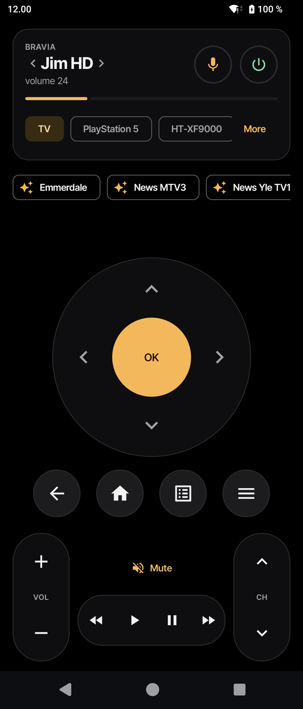
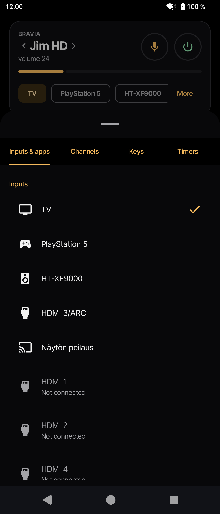
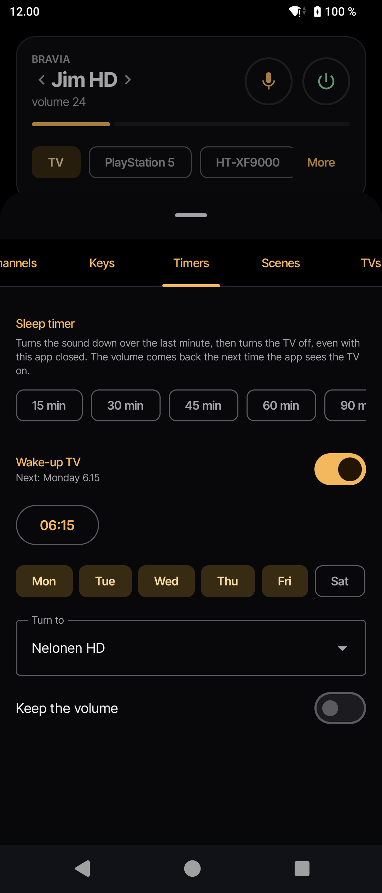
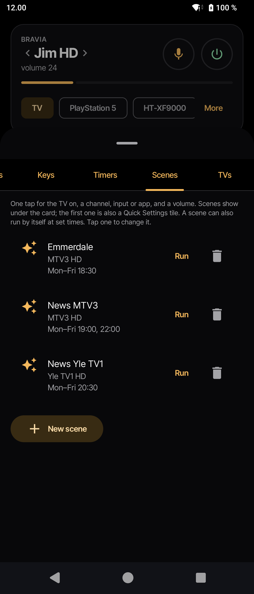

# Sohva Remote

A fast, ad-free phone remote for Sony Bravia TVs, on the local network only ("sohva" is
Finnish for sofa). Built for a 2018 KD-65XF9005 (Android TV); other Bravias with IP
control should work too. No cloud, no account, no analytics. Not affiliated with Sony.

Package `fi.digable.sohva`, by Digable. Landing page: https://digablesolutions.github.io/sohva-remote/

<p>
  
  
  
  
</p>

## Features

**The remote**
- Finds the TV with SSDP (or add it by IP address); PIN pairing, cookie stored encrypted
  and renewed silently. Re-finds the TV by UUID when its IP address changes.
- "Fast keys" over the TV's Android TV Remote protocol (one-time pairing): D-pad, OK,
  Back, Home, volume and channel keys arrive in tens of milliseconds. Other keys use IRCC.
- Power, volume, mute, D-pad, Back, Home, Guide, Options, playback, channel up/down;
  haptics and long-press repeat. The phone's volume buttons change the TV volume.
- Touchpad mode: swipe to move, tap for OK, rest the finger to keep moving; a toggle
  beside the D-pad switches between the two.
- The card shows what's on (channel or app); swipe it to change channel. "Jump back"
  chip returns to the channel watched before.
- More sheet: the TV's inputs, installed apps (icons cached on the phone), the channel
  list, number pad and extra keys, timers, scenes, saved TVs.
- Type on the TV: when the TV's keyboard is up, type (or dictate) from the phone.
- Voice commands in Finnish and English: "kanava 3", "volume 20", "Netflix",
  "PlayStation", "mute", "turn off".

**Without opening the app**
- Quick Settings tiles: power, mute, guide, and the first scene.
- Home-screen widget: volume, channel and mute.
- Mute the TV while a phone call rings or is on, unmute after (opt-in).

**Automations**
- Sleep timer: turns the sound down over the last minute, then the TV off; the volume
  comes back the next time the app sees the TV on.
- Wake-up TV: switches the TV on at a set time on chosen days, to a channel, input or
  app, and a volume.
- Scenes: one tap for the TV on + a channel, input or app + a volume ("Game time":
  PS5 at volume 30). A scene can also run on a schedule, e.g. MTV3 on weekdays at
  18.30 for Emmerdale. A scheduled scene only acts while the TV is on; it never
  switches the TV on (that's the wake-up's job).

Timers, the wake-up and scheduled scenes use exact alarms and a short foreground
service, so they work with the app closed and the phone in Doze.

## Requirements

- Android 8.0 (API 26) or newer.
- On the TV: Settings › Network › Home network setup › IP control
  - Authentication: "Normal and Pre-Shared Key"
  - Remote start: On (needed to switch the TV on from standby)
- Phone and TV on the same network.

## Install

A Google Play release is being prepared (listing in `fastlane/`). Until then, sideload:

- **From CI:** every push builds a debug APK on GitHub Actions. Open the run under the
  **Actions** tab and download the `sohva-remote-debug-apk` artifact.
- **From source:** `./gradlew assembleRelease` gives a minified (R8) APK; `bundleRelease`
  gives the AAB for Play. Both are signed with the upload key when `keystore.properties`
  exists, otherwise with the debug key.

On first start the app finds the TV and asks for the PIN the TV shows. Fast keys ask
for a second, one-time PIN from the TV's Android TV Remote service.

## Permissions

| Permission | Why |
|---|---|
| `INTERNET`, `ACCESS_NETWORK_STATE`, `ACCESS_WIFI_STATE`, `CHANGE_WIFI_MULTICAST_STATE` | Talk to the TV on the LAN and find it with SSDP. |
| `SCHEDULE_EXACT_ALARM` | Sleep timer, wake-up and scheduled scenes on time, also in Doze. On Android 12+ you allow it in settings; the Timers and Scenes tabs link there. |
| `FOREGROUND_SERVICE`, `WAKE_LOCK` | Keep the phone awake for the minute a timer needs to reach the TV. |
| `RECEIVE_BOOT_COMPLETED` | Set the alarms again after a restart. |
| `READ_PHONE_STATE` | Only for "Mute during calls", asked when you switch it on. |
| `VIBRATE` | Haptic feedback. |

Microphone access goes through Android's own speech recognizer; the app never records
audio itself.

## Privacy

Everything stays between the phone and the TV. The app makes no calls outside the local
network. The TV's cookie, PSK and Android TV Remote certificate are stored encrypted
(Android Keystore) and are excluded from backups.

## Known limits

- With an HDMI-CEC soundbar the TV moves the volume two steps per key and one step per
  "set volume" call; the app steps and reads back to reach a level.
- Devices found over HDMI-CEC (e.g. a PS5) are listed only while awake; scenes save
  them by HDMI port so they still work when the device sleeps.
- Apps with their own on-screen keyboard (YouTube) don't raise the TV's keyboard, so
  there is nothing to type into.
- Live TV can't be previewed on the phone (protected video).
- After a phone restart, alarms come back at the first unlock.

## Build and verify

Requirements: JDK 17+, Android SDK platform 36 and build-tools 36.

```
./gradlew testDebugUnitTest lintDebug assembleDebug   # run before every commit
./gradlew assembleRelease                             # R8 build, debug-signed
```

Unit tests run the protocol code against fake TVs (`FakeBraviaTv` on MockWebServer,
`FakeAtvTv` over TLS). Device smoke tests are described in [AGENTS.md](AGENTS.md).

## Layout

```
app/src/main/java/fi/digable/braviaremote/
  protocol/   Pure Kotlin, no Android: BraviaApi (Scalar JSON-RPC + IRCC), PinPairing,
              SsdpDiscovery, WakeOnLan, RemoteKey; Android TV Remote: AtvPairing,
              AtvRemote, AtvWire, AtvTls.
  data/       TvController (the one live session), TvStore (DataStore), CredentialStore,
              SleepTimer, WakeUpAlarm + SceneSchedule + WakeUpService, CallMute,
              Automations (Scene, WakeUp, TvTarget).
  shortcuts/  Quick Settings tiles and the home-screen widget.
  voice/      Voice command parser (Finnish/English).
  ui/         Compose screens: discover, pair, remote, More sheet tabs.
app/src/test/ Unit tests and the fake TVs.
site/         Landing page (static, not published yet) and screenshots in site/img.
.claude/skills/  Project agent skills (Android, Compose, Kotlin), pinned in skills-lock.json.
```

Contributor and agent conventions: [AGENTS.md](AGENTS.md).
